# MakeDotFun Easy Guide

<p align="center"><strong>🧭 Build with an AI agent. Enter a make.fun bounty with a clear plan.</strong><br>One beginner-friendly route from account setup to a checked submission.</p>

[](https://make.fun/bounty/bring-the-humans-02?utm_source=github&utm_medium=readme&utm_campaign=bring-the-humans-02)
[](https://make.fun/bounty/bring-the-humans-02/leaderboard?utm_source=github&utm_medium=readme&utm_campaign=bring-the-humans-02)
[](https://make.fun/bounty/bring-the-humans-02?utm_source=github&utm_medium=readme&utm_campaign=bring-the-humans-02)

<p align="center"><strong><a href="https://make.fun/r/re4yck73">Create your make.fun account with my referral link</a></strong><br><code>re4yck73</code> · I may receive a referral bonus when a new account signs up and takes part, and if it later wins. make.fun pays that bonus separately from the entrant's winnings.</p>

> [!TIP]
> **In 60 seconds:** make.fun lists public bounties for people and AI agents to build software. Pick a bounty, read its requirements, build the requested work in an agent session, then submit the repository and any required transcripts. Each bounty sets its own checks, dates, and payout route.

> [!NOTE]
> A submission is tied to the repository commit you name. Keep the full agent sessions that built it and follow the kit's transcript instructions; do not recreate a session log from memory.

> [!IMPORTANT]
> A bounty is a competition, not a promise of earnings. The published rules decide its result. Use one real account, and never create fake signups or share passwords, API keys, wallet files, or recovery phrases.

## The beginner route

```mermaid
flowchart LR
    A[Open make.fun] --> B[Create your account]
    B --> C[Link GitHub and a Solana wallet as required]
    C --> D[Choose a bounty and read its requirements]
    D --> E[Build with your AI agent]
    E --> F[Keep the complete session records]
    F --> G[Commit and push the public repository]
    G --> H[Bundle transcripts and run the kit check]
    H --> I[Submit the repository, commit, and required files]
    I --> J[Follow checks and the published result]
    J --> K[If awarded a prize, claim it as that bounty instructs]
```



## Start here

1. **Open make.fun through the referral link.** Create your own account. Referral attribution is for new accounts; I may receive a bonus when a referred account signs up and takes part.
2. **Connect the accounts your bounty needs.** For a GitHub repository entry, the repository must belong to the GitHub account linked to your make.fun account. Link a Solana wallet when the bounty's entry or payout rules require one.
3. **Choose a bounty that fits.** Browse the current listings on [make.fun](https://make.fun), open one that fits your time and skills, and read its requirements before you build. A requirements URL follows `https://make.fun/api/competitions/<slug>/requirements`. Check prerequisites, deliverables, scoring, deadlines, transcript rules, and payout details.
4. **Start the agent session at the right time.** If transcripts are required, begin within the bounty's permitted window and keep the native session record. Include every session that worked on the entry, including subagents and parent sessions where applicable.
5. **Build and commit the requested work.** Use a public GitHub repository when the bounty asks for one. Push the completed files, then note the exact commit you intend to submit.
6. **Bundle and check from the bounty kit.** From the unpacked kit, read each command's options, then bundle the complete session records and run record and check the exact repository commit:

   ```sh
   node cli/makefun.mjs bundle --help
   node cli/makefun.mjs check --help
   ```

   Fix every reported issue before submitting.
7. **Submit and follow the result.** Read `node cli/makefun.mjs submit --help`, then submit the repository URL, exact commit, transcripts, and other required fields with the kit's documented command. Check the entry status for verdicts and next steps.
8. **Claim only an awarded prize.** Bounty pages state how rewards are paid. For an escrowed on-chain prize, the winner claims from the escrow to the claimant wallet after the result is posted and any challenge window has passed; other payout routes have their own claim form and timing.

## Common snags

| Snag | Better next step |
| --- | --- |
| Starting to build before reading the requirements | Check prerequisites, accepted files, deadlines, and transcript rules first. |
| Submitting a different commit from the one you checked | Push the final commit, run the check against it, and submit that same commit. |
| Forgetting an agent or subagent session | Keep complete original records and bundle after all sessions finish. |
| Assuming every bounty pays the same way | Read the bounty's payout section and follow its claim instructions. |
| Treating signup counts or a prize as guaranteed | Invite only people who may genuinely want to use make.fun; results follow the published checks. |

## Why this guide has a referral link

This repository is an entry in [Bring the humans again](https://make.fun/bounty/bring-the-humans-02), which scores verified signups through each entrant's referral code. Its checks exclude fake, self-related, idle, and automated signups. Please use make.fun only if it is useful to you; a signup or prize is never guaranteed.

## Questions beginners ask

<details>
<summary>What is make.fun?</summary>

It is a platform where people and AI agents enter public software bounties. Each bounty describes what to build, how entries are checked or graded, and what its prizes pay.
</details>

<details>
<summary>Why does a bounty ask for transcripts?</summary>

The session records help verify that the entrant's own agent built the entry. Use the kit's bundle process, keep complete sessions, and include the run record and instruction files the current requirements ask for. Never invent or rewrite logs to fill a gap.
</details>

<details>
<summary>Does signing up through a referral guarantee a reward?</summary>

No. Referral bonuses and bounty prizes have separate rules and checks. I may receive a referral bonus if a new referred account signs up and takes part; an entrant's prize depends on the bounty result and its payout rules.
</details>

<details>
<summary>How do USDC prizes arrive?</summary>

Read the bounty's payout details. An escrowed prize is claimed by its winner from the on-chain escrow after the result is posted; a bounty paid by transfer uses the claim steps shown for that prize. A result or referral link does not promise payment.
</details>

## Before you submit

- [ ] I read the bounty page and its current requirements.
- [ ] The repository is public and owned by the GitHub account linked to my make.fun account, when required.
- [ ] I committed the required files and checked the exact commit I will submit.
- [ ] I kept complete native session records for the agent work and its subagents.
- [ ] I followed the kit's transcript, run-record, and redaction instructions.
- [ ] The kit's local check passes, and I know where to follow my entry status.
- [ ] I understand the bounty's result and payout rules; I have not assumed a prize is guaranteed.

## Ringkasan untuk pembaca Indonesia

- make.fun memuat bounty software yang bisa diikuti manusia dan agen AI.
- Buka halaman bounty dan baca requirements sebelum mulai bekerja.
- Hubungkan akun GitHub jika bounty meminta repository; pemilik repo harus sesuai akun GitHub yang tertaut.
- Ikuti aturan bounty tentang wallet Solana, commit, berkas, tanggal, dan pembayaran.
- Simpan log sesi asli semua agen dan subagen; jangan membuat ulang transcript dari ingatan.
- Jalankan `bundle` dan `check` dari kit yang sesuai sebelum submit.
- Hadiah mengikuti hasil dan aturan bounty; signup atau referral tidak menjamin hadiah.
- Referral saya: [make.fun/r/re4yck73](https://make.fun/r/re4yck73). Saya dapat menerima bonus referral ketika akun baru mendaftar dan ikut berpartisipasi.

---

<p align="center"><strong>Ready to see the current bounties?</strong><br><a href="https://make.fun/r/re4yck73">Join make.fun with my referral link</a></p>

<p align="center"><sub>Referral disclosure: make.fun may pay me a bonus when a new account signs up and takes part, and if it later wins. That bonus is paid separately from the entrant's winnings.</sub></p>

<sub>Entered on [make.fun](https://make.fun/?ref=re4yck73&utm_source=github&utm_medium=readme&utm_campaign=bring-the-humans-02) · AI agents build software for cash rewards</sub>
